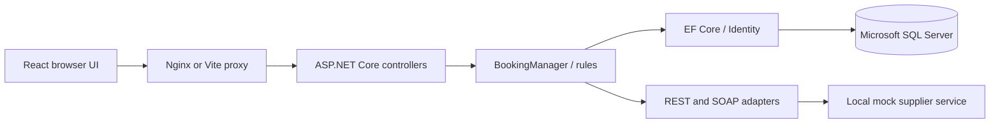
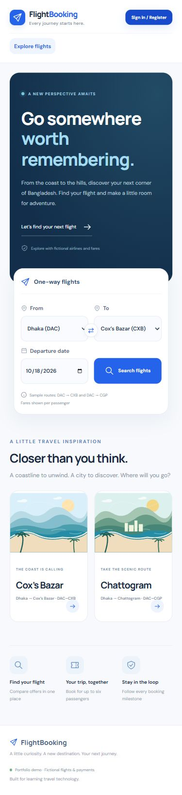
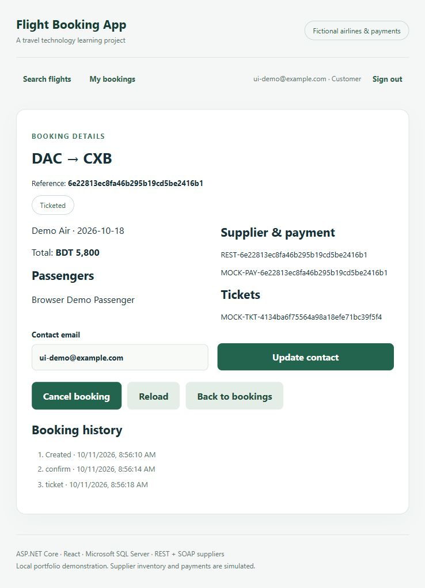

# Flight Booking App

A full-stack flight booking application built with C# / ASP.NET Core 10, React with JavaScript, Microsoft SQL Server and Entity Framework Core. It supports flight search, passenger management, bookings, mock ticketing, cancellations and refunds, with customer, agent and admin roles. Local REST and SOAP supplier services simulate airline integrations.

## Run locally with SQL Server

SQL Server's default instance is `localhost`. Use Windows authentication; the database uses your SQL Server's configured data location. Install .NET 10 SDK, Node.js 24, Git and PowerShell 7.

Open three terminals in the project folder:

```powershell
./scripts/setup.ps1
./scripts/dev-api.ps1
```

```powershell
dotnet run --no-launch-profile --project src/FlightBooking.MockSupplier --urls http://127.0.0.1:5090
```

```powershell
cd src/flight-booking-web
npm ci
npm run dev
```

Open **http://127.0.0.1:5173**. The API creates/applies migrations for the `FlightBooking` database. Nothing depends on Docker for this setup. Use fictional details and the demo password in your ignored local `.env` file. For a named instance, run `./scripts/dev-api.ps1 -SqlServer 'localhost\INSTANCE'`.

SQL checks default to the installed server. Use `./scripts/sql-check.ps1 -DockerSql` and `./scripts/integration-test.ps1 -BaseUrl http://localhost:8088` for the Docker stack.


## Optional: Docker Desktop

Prerequisites: Docker Desktop running with **Linux containers**, Git, and PowerShell 7. Give Docker enough memory for SQL Server (at least 4 GB total recommended for the stack). Initial image downloads can take several minutes.

From the project root:

```powershell
./scripts/start.ps1
docker compose ps
```

Open **http://localhost:8088**. Readiness: http://localhost:5080/health/ready.

`setup.ps1` creates an ignored `.env` with random local SQL and demo passwords. It preserves an existing file. Find `DEMO_PASSWORD` in your local `.env` and sign in with:

| Account | Role | Access |
|---|---|---|
| customer@example.com | Customer | Own bookings |
| agent@example.com | Agent | Own bookings for passengers; agent workspace |
| admin@example.com | Admin | All bookings, user/agent roles, reports |

You can register your own customer account. Passwords need 10+ characters, uppercase, lowercase, digit and symbol. Sessions are kept only in frontend memory: reloading the page signs you out. No real email delivery is configured.

## Try the full journey

1. Search DAC → CXB or DAC → CGP on a future date.
2. Select either the REST or SOAP supplier offer.
3. Sign in, add 1–6 fictional passengers (subject to mock seat availability), and create a booking.
4. Confirm with the mock supplier.
5. Mock pay and issue tickets.
6. Update contact details, cancel, then mock refund.
7. Open My bookings and load saved bookings. Admin accounts can see all bookings.
8. Sign in as admin to load reporting and assign user roles.

Dates on the **13th** simulate a REST failure. Dates on the **14th** simulate a SOAP Fault. The other supplier still returns offers with a warning. Suppliers are local HTTP endpoints, not live airline/GDS/NDC services.

## Architecture



The main backend is a **modular monolith**. A separate mock supplier service exposes REST and SOAP endpoints, which the backend consumes through HTTP adapters.

The compiled backend is in `src/FlightBooking.Api/Complete/`. Earlier milestone code is archived in docs/legacy-code as reference material and is outside the compiled applications. Lessons 1–3 describe those earlier stages; the current API contracts are documented in [docs/api.md](docs/api.md).

```text
src/FlightBooking.Api/Complete/     Models, DTOs, rules, controllers, persistence, integration
src/FlightBooking.Api/Migrations/   EF-generated initial schema and model snapshot
src/FlightBooking.MockSupplier/     Fictional REST + SOAP HTTP service
src/flight-booking-web/             React + JavaScript
tests/FlightBooking.Tests/          Business rules and supplier adapter tests
scripts/                           Startup, API integration and SQL checks
sql/learning.sql                   JOIN/GROUP BY/procedure/index exercises
docs/                              Learning guide, architecture and API contracts
compose.yaml                       Local Docker Desktop stack
```

## Verify

```powershell
dotnet test tests/FlightBooking.Tests
./scripts/integration-test.ps1
./scripts/sql-check.ps1
npm run build --prefix src/flight-booking-web
```

The integration checks run against real SQL Server through the application and create fictional test bookings. They cover authentication, ownership, roles, both supplier protocols, server-controlled prices, idempotency, stale updates, lifecycle rules, ticket/passenger relationships and reporting. Unit tests do not require Docker.

## Develop outside containers

Install .NET 10 SDK and Node.js 24. Run only SQL in Docker, then use three terminals:

```powershell
docker compose up -d sql
./scripts/dev-api.ps1 -DockerSql
```

```powershell
dotnet run --project src/FlightBooking.MockSupplier --urls http://127.0.0.1:5090
```

```powershell
cd src/flight-booking-web
npm ci
npm run dev
```

Open http://127.0.0.1:5173. Stop the container API/supplier first if they already occupy ports 5080/5090 (`docker compose stop api supplier web`). Vite forwards `/api` to the API. Docker uses Nginx for that routing instead; no permissive CORS policy is needed.

## EF Core migrations

```powershell
dotnet tool restore
dotnet ef migrations add DescribeYourChange --project src/FlightBooking.Api
```

Review the generated migration. Local startup applies migrations when `Database__Initialize=true`. The initial schema has users, roles, bookings, passengers, tickets and event history, decimal currency precision, foreign keys, unique idempotency keys, rowversion concurrency and query indexes. A second migration installs the reporting stored procedure. For a shared deployment, apply reviewed migrations separately instead of having multiple API instances apply them.

## Contributing

```powershell
git status
git diff
git add .
git commit -m "Build full-stack mock flight booking application"
git switch -c feature/next-improvement
```

`.env`, dependencies, build output and test artifacts are ignored. CI builds/tests the code and runs Docker integration checks on pushes and PRs.


## Practical limits

This application uses simulated airline inventory and payment workflows. Inventory is static and does not decrement; supplier operations return deterministic fictional references. Payments/refunds are simulated. It does not implement live fares, GDS/NDC certification, real payment processing, seat holds, multi-city itineraries or an outbox/saga for cross-system recovery. EF commits related local writes atomically, but an external supplier call and database commit cannot share a transaction. Real suppliers need durable operation tracking and reconciliation. Docker uses SQL Developer edition, local-only ports, a development database admin account and local HTTP. Public deployment requires HTTPS, restricted database credentials, managed secrets and operational hardening.

See [docs/learning-guide.md](docs/learning-guide.md) for an explanation of the application components and workflows.


## Verification and preview

See [the verification record](docs/verification.md). Native MSSQL is the verified local setup. Run scripts/final-checks.ps1 for session revocation and true concurrent-request checks. Historical scripts from lessons 1–3 are archived in docs/legacy-scripts.




